  

# 🚀 Awesome Rust Shells & Modern Command Line Tools 🦀⚡

  
  
  
  
  
  

---

## 🌟 Top Rust Shells & Modern Command Line Tools Ecosystem 🛠️

**Curated Directory of Cloud SaaS Platforms & High-Performance Open-Source GitHub Projects**  
*Focused on Next-Gen Rust Shells, Structured Data Pipelines, Cross-Shell Prompts, GPU-Accelerated Terminals & Modern CLI Coreutils Replacements.*  

**Last updated: November 2026**

This repository tracks the modern **Rust Shells & Modern Command Line Tools** landscape revolutionizing developer workflows. By leveraging Rust's memory safety, fearless concurrency, zero-cost abstractions, and blazing execution speed, these tools replace aging Unix utilities (GNU coreutils, bash, find, grep, ls, cat) with structured pipelines, cross-platform terminal multiplexers, AI-augmented developer shells, and GPU-rendered consoles.

Whether you are looking to query unstructured logs as SQL-style tables using Nushell, sync your encrypted shell command history across machines with Atuin, run lightning-fast searches using ripgrep and fd, or boost your terminal framerates with WezTerm and Alacritty, this directory aggregates production-grade SaaS solutions and top open-source repositories.

---

## 📑 Table of Contents

- [📊 Sector Overview & Market Dynamics](#-sector-overview--market-dynamics)
- [☁️ SaaS/Hosted Terminal & Shell Platforms](#️-saashosted-terminal--shell-platforms)
- [💻 Open-Source GitHub Projects](#-open-source-github-projects)
- [📈 Star History](#-star-history)
- [🤝 How to Contribute](#-how-to-contribute)
- [💖 Support](#-support)
- [⚠️ Disclaimer](#️-disclaimer)

---

## 📊 Sector Overview & Market Dynamics

The global developer tools and command-line terminal environment market is estimated at approximately **$4.8B – $6.2B** in 2025–2026 and is projected to expand toward **$12B+ by 2032** at an 11% – 14% CAGR, driven by cloud-native infrastructure, developer productivity optimization, remote server fleet orchestration, and generative AI terminal assistance.

The terminal and CLI ecosystem is **moderately fragmented**: foundational developer primitives remain heavily community-driven and open-source (dominated by iconic Rust utilities like ripgrep, starship, and bat), while the commercial SaaS tier is seeing growing consolidation around AI-augmented team terminal environments (Amazon Q CLI / Fig, Warp, GitHub Codespaces) and cloud-synced credential/vault managers (Termius).

---

## ☁️ SaaS/Hosted Terminal & Shell Platforms

Below is a comparison of leading managed cloud terminal, developer environment, and shell history platforms, sorted in descending order by company scale (**Market Capitalization / Enterprise Valuation / Estimated Annual Revenue**):

| Platform | Company Scale (Valuation / Revenue) | Starting Price (Paid Tier) | Free Tier / Trial Limits | Key Architecture & Features |
| :--- | :--- | :--- | :--- | :--- |
| **[Amazon Q CLI / Fig](https://aws.amazon.com/q/developer/)** | **~$2.1T Market Cap** *(Amazon AMZN; ~$620B ARR)* | **$19 / user / month** *(Amazon Q Developer Pro)* | **Free tier available** *(Includes terminal completions, natural language bash translations, and 50 monthly AI queries)* | Cloud-connected terminal intelligence providing IDE-style autocomplete and inline command translation for Zsh, Bash, Fish, and PowerShell. |
| **[GitHub Codespaces](https://github.com/features/codespaces)** | **~$3.1T Parent Cap** *(Microsoft MSFT; ~$1B+ GitHub ARR)* | **$0.18 / hour** *(2-core VM baseline pay-as-you-go)* | **Free forever: 120 core-hours/month** *(Plus 15 GB storage per month included on all GitHub accounts)* | Fully managed cloud developer shells and remote containerized terminal environments accessible via web browser or local SSH/VS Code. |
| **[Warp](https://warp.dev)** | **~$500M+ Valuation** *(Series B backed; ~$25M+ ARR)* | **$15 / user / month** *(Team Plan)* | **Free forever plan** *(Full GPU terminal, up to 3 team members, and 100 AI request credits per month)* | Modern Rust-engineered GPU terminal featuring block-based editing, integrated Warp AI assistant, and shared team runbooks via Warp Drive. |
| **[Termius](https://termius.com)** | **~$50M+ Private Valuation** *(Bootstrap/Series A; ~$15M ARR)* | **$10 / user / month** *(Pro Plan)* | **14-day free trial** *(Pro features)* *(Basic free tier with local SSH & SFTP on unlimited devices, sync requires Pro)* | Cross-platform terminal workspace and SSH client with end-to-end encrypted cloud vault synchronization for servers, SSH keys, and snippets. |
| **[Atuin Cloud Sync](https://atuin.sh)** | **Seed-stage / Commercial OSS** *(Open-source backing; &lt;$2M ARR)* | **$4 / month** *(Atuin Cloud Hosted Vault)* | **Free forever: Self-hosted server** *(Or 30-day free trial on managed cloud sync with unlimited history records)* | End-to-end encrypted SQLite shell history sync engine, preserving rich metadata, exit codes, and cross-machine search indexing. |

---

## 💻 Open-Source GitHub Projects

The table below catalogs premier open-source Rust shells, terminal emulators, prompt engines, and modern command-line replacements for classic GNU/Unix utilities, sorted in descending order by **GitHub_Stars_Count**:

| Repository | GitHub_Stars | Language | Primary Category | Replaces / Role & Key Capabilities |
| :--- | :--- | :--- | :--- | :--- |
| **[ripgrep](https://github.com/BurntSushi/ripgrep)** |  | `Rust` | Search / Text Processing | **Replaces `grep`**. Ultra-fast recursive line-oriented regex search adhering strictly to `.gitignore` rules. |
| **[Alacritty](https://github.com/alacritty/alacritty)** |  | `Rust` | Terminal Emulator | GPU-accelerated (OpenGL) cross-platform terminal emulator focused on raw performance and minimal latency. |
| **[bat](https://github.com/sharkdp/bat)** |  | `Rust` | Text Viewing / Pager | **Replaces `cat`**. Syntax-highlighting file viewer with native Git modifications integration and paging. |
| **[Starship](https://github.com/starship/starship)** |  | `Rust` | Prompt Engine | Minimal, lightning-fast, and infinitely customizable cross-shell prompt for any shell environment. |
| **[fd](https://github.com/sharkdp/fd)** |  | `Rust` | File Finding | **Replaces `find`**. Simple, fast, and user-friendly alternative to `find` with colored output and smart regex. |
| **[Nushell](https://github.com/nushell/nushell)** |  | `Rust` | Shell Environment | Modern shell treating all command output as structured tables and typed data streams rather than raw text. |
| **[zoxide](https://github.com/ajeetdsouza/zoxide)** |  | `Rust` | Navigation | **Replaces `cd`**. Smarter directory navigation helper that learns frequently visited paths for instant fuzzy jumping. |
| **[just](https://github.com/casey/just)** |  | `Rust` | Task Runner | **Replaces `make`**. Modern command runner and task automation utility designed specifically for dev workflows. |
| **[Zellij](https://github.com/zellij-org/zellij)** |  | `Rust` | Terminal Multiplexer | **Replaces `tmux`**. Modern terminal workspace with floating panes, built-in layouts, and WebAssembly plugin engine. |
| **[fish-shell](https://github.com/fish-shell/fish-shell)** |  | `Rust` / `C++` | Shell Environment | Smart, user-friendly interactive shell featuring autosuggestions, syntax highlighting, and Rust rewrite (4.0+). |
| **[delta](https://github.com/dandavison/delta)** |  | `Rust` | Git Pager | **Replaces `diff`**. Syntax-highlighting pager for git, diff, and grep output with line numbers and side-by-side view. |
| **[Atuin](https://github.com/atuinsh/atuin)** |  | `Rust` | History Management | Magical shell history replacement storing commands in SQLite with fuzzy search and end-to-end encrypted sync. |
| **[WezTerm](https://github.com/wez/wezterm)** |  | `Rust` | Terminal Emulator | GPU-accelerated cross-platform terminal emulator and multiplexer configured via Lua with SSH domains. |
| **[hyperfine](https://github.com/sharkdp/hyperfine)** |  | `Rust` | Benchmarking | Command-line benchmarking tool with statistical analysis, warmup runs, and automated Markdown export. |
| **[difftastic](https://github.com/Wilfred/difftastic)** |  | `Rust` | Structural Diff | Structural syntax-aware diff tool using Tree-sitter parsers to compare ASTs rather than text lines. |
| **[uutils coreutils](https://github.com/uutils/coreutils)** |  | `Rust` | Core Utilities | **Replaces GNU `coreutils`**. Full drop-in memory-safe Rust reimplementation of classic GNU coreutils. |
| **[eza](https://github.com/eza-community/eza)** |  | `Rust` | File Listing | **Replaces `ls`**. Modern, maintained fork of exa featuring file type icons, tree view, and Git status indicators. |
| **[Oh My Posh](https://github.com/JanDeDobbeleer/oh-my-posh)** |  | `Go` / `Rust` | Prompt Engine | Ultra-customizable shell prompt engine supporting all platforms, glyphs, and themes. |
| **[gitui](https://github.com/extrawurst/gitui)** |  | `Rust` | Git TUI | Blazing-fast terminal GUI for git operations providing smooth 60fps keyboard-driven interaction. |
| **[spotify-tui](https://github.com/Rigellute/spotify-tui)** |  | `Rust` | Media Control | Spotify for the terminal written in Rust, offering complete music playback control directly inside terminal panes. |
| **[duf](https://github.com/muesli/duf)** |  | `Go` | Disk Usage | **Replaces `df`**. User-friendly disk usage utility displaying storage volume allocations in intuitive colored tables. |
| **[tokei](https://github.com/XAMPPRocky/tokei)** |  | `Rust` | Code Statistics | **Replaces `cloc`**. Blazing-fast CLI utility displaying comprehensive statistics about lines of code, comments, and blanks. |
| **[bottom](https://github.com/ClementTsang/bottom)** |  | `Rust` | Process Monitor | **Replaces `top` / `htop`**. Graphical process and system monitor featuring real-time CPU, memory, and disk telemetry. |
| **[broot](https://github.com/Canop/broot)** |  | `Rust` | Tree Explorer | **Replaces `tree`**. Interactive tree view designed for navigating directory hierarchies and launching commands. |
| **[gping](https://github.com/orf/gping)** |  | `Rust` | Networking | **Replaces `ping`**. Visual ping utility with real-time graphical latency plots rendered directly in the terminal. |
| **[dust](https://github.com/bootandy/dust)** |  | `Rust` | Disk Analysis | **Replaces `du`**. Intuitive disk usage analyzer presenting tree-based folder consumption visual graphs. |
| **[pixi](https://github.com/prefix-dev/pixi)** |  | `Rust` | Package Manager | Ultra-fast cross-platform package management and environment tool built on the Conda ecosystem in Rust. |
| **[Rio](https://github.com/raphamorim/rio)** |  | `Rust` | Terminal Emulator | Hardware-accelerated terminal emulator written in Rust capable of running natively on desktop and inside browsers via WASM. |
| **[sd](https://github.com/chmln/sd)** |  | `Rust` | String Manipulation | **Replaces `sed`**. Intuitive search-and-replace CLI tool with standard regex syntax and substantially faster execution. |
| **[skim](https://github.com/lotabout/skim)** |  | `Rust` | Fuzzy Finder | **Replaces `fzf`**. General-purpose fuzzy finder written in Rust supporting multi-selection and interactive previewing. |
| **[dog](https://github.com/ogham/dog)** |  | `Rust` | DNS Lookup | **Replaces `dig`**. Command-line DNS client supporting DNS-over-TLS (DoT) and DNS-over-HTTPS (DoH) with colorful output. |
| **[tealdeer](https://github.com/dbrgn/tealdeer)** |  | `Rust` | Documentation | **Replaces `man` / `tldr`**. Ultra-fast implementation of `tldr` providing practical, simplified cheatsheets. |
| **[dua-cli](https://github.com/Byron/dua-cli)** |  | `Rust` | Disk Analysis | Parallel disk usage analyzer and interactive terminal directory cleaner written in Rust. |
| **[procs](https://github.com/dalance/procs)** |  | `Rust` | Process Viewer | **Replaces `ps`**. Modern replacement for `ps` displaying colored process hierarchies, port bindings, and Docker info. |
| **[choose](https://github.com/theryangeary/choose)** |  | `Rust` | Text Parsing | **Replaces `cut` / `awk`**. Human-friendly and fast field selection tool with Python-style negative indexing and slice notation. |
| **[Ion Shell](https://gitlab.redox-os.org/redox-os/ion)** |  | `Rust` | System Shell | Modern high-performance shell designed for Redox OS and Linux featuring clean syntax and blazing execution. |
| **[shell-rs](https://github.com/since2006/shell-rs)** |  | `Rust` | Unix Shell | Systems-programming Unix shell implementation in Rust exploring safe command pipelines and process control. |

---

## 📈 Star History

#

---

## 🤝 How to Contribute

We welcome community contributions! To add a new Rust shell, terminal tool, or modern CLI utility:

1. 🍴 **Fork the repository** on GitHub.
2. 🌿 **Create a new branch** (`git checkout -b add-cli-tool`).
3. 📝 **Add your entry** under the appropriate table or section (ensure descriptions are concise and factual).
4. 📬 **Submit a Pull Request** with a brief summary of why the tool is beneficial to the command-line ecosystem.

For curated lists across other engineering domains, explore [Awesome-Awesome-Awesome](https://github.com/ishandutta2007/Awesome-Awesome-Awesome).

---

## 💖 Support

If you find this directory valuable for your developer workflow or terminal configuration:
- ⭐ **Star this repository** on GitHub to help other engineers discover it.
- 🍴 **Fork and share** with your DevOps, platform, and systems programming teams.
- ☕ **Sponsor the maintainer** or buy a coffee via the [GitHub Sponsor Dashboard](https://github.com/sponsors/ishandutta2007).

---

## ⚠️ Disclaimer

- This is an independent, community-maintained ecosystem directory and does not constitute an endorsement.
- Replacing `/bin/sh` or system default POSIX shells with non-POSIX shells like **Nushell** or **Ion** can break legacy startup scripts; set modern Rust shells as your interactive terminal shell while keeping `/bin/sh` intact for system scripts.
- When syncing shell history with tools like **Atuin**, enable secret filtering (`secrets_filter = true`) and end-to-end encryption so accidental API keys or passwords typed in commands are never leaked.

---

  <b>Built with ❤️ for Rustaceans, Systems Engineers, DevOps Architects, and Terminal Power Users.</b> 
  <i>Empowering developers with blazing-fast, memory-safe, and structured command-line workflows.</i>

